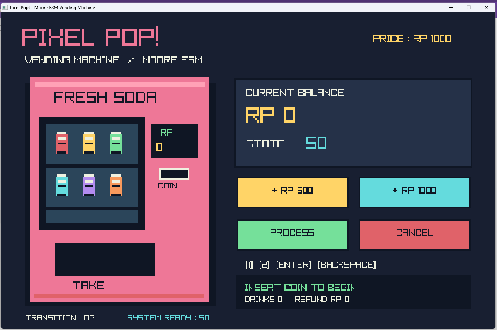

<div align="center">

# 🥤 PIXEL POP!
### A tiny retro vending machine powered by a Moore finite state machine

**C++17 · raylib · Pixel Art · State Machine Simulation**



</div>

## About

**PIXEL POP!** is a desktop vending machine simulator inspired by classic pixel games and created to explore **Moore finite state machine (FSM)** design. It turns a small embedded-systems exercise into an interactive visualization: insert virtual coins, process a purchase, cancel it, and watch the current FSM state update live.

One drink costs **Rp1,000**. The machine accepts **Rp500** and **Rp1,000**, and requires a separate **PROCESS** input before it dispenses a drink.

## Features

- 🎮 Retro pixel-art interface drawn directly in raylib — no external sprites required
- 🪙 Interactive Rp500 and Rp1,000 coin buttons
- 🥤 Drink dispensing on successful purchase
- ↩️ Cancellation refunds and excess-coin returns
- 🔎 Live balance, current state, and transition log
- ⏲️ Visible one-second simulated clock transitions for output states
- ⌨️ Mouse and keyboard controls

## Demo controls

| Action | Key |
| --- | --- |
| Insert Rp500 | `1` |
| Insert Rp1,000 | `2` |
| Process transaction | `Enter` |
| Cancel transaction | `Backspace` |
| Toggle transition history | `L` |
| Exit | `Esc` |

All transaction actions also have on-screen buttons.

## Finite state machine

The application uses a **Moore FSM**: outputs are associated with states rather than being issued directly by each input.

| State | Meaning | Output / next step |
| --- | --- | --- |
| `S0` | Idle, balance Rp0 | Wait for coin |
| `S500` | Balance Rp500 | Wait for additional coin or cancel |
| `S1000` | Balance Rp1,000 | Wait for PROCESS, CANCEL, or extra coin |
| `UB500` | Excess Rp500 | Return Rp500, then `S1000` |
| `UB1000` | Excess Rp1,000 | Return Rp1,000, then `S1000` |
| `UA500` | Cancel from Rp500 | Return Rp500, then `S0` |
| `UA1000` | Cancel from Rp1,000 | Return Rp1,000, then `S0` |
| `DROP` | Successful purchase | Dispense drink, then `S0` |

For example:

```text
S0 --(+500)--> S500 --(+500)--> S1000 --(PROCESS)--> DROP --(clock)--> S0
S0 --(+500)--> S500 --(CANCEL)--> UA500 --(clock)--> S0
S0 --(+500)--> S500 --(+1000)--> UB500 --(clock)--> S1000
```

Inputs are temporarily ignored while a refund or dispensing output state is active. These states advance automatically after a one-second visual delay, simulating a clock event. Pressing PROCESS without enough balance does not dispense a drink.

## Build and run on Windows (MSYS2 UCRT64)

1. Install [MSYS2](https://www.msys2.org/) and open the **UCRT64** shell.
2. Install the GCC compiler and raylib:

   ```bash
   pacman -S --needed mingw-w64-ucrt-x86_64-gcc mingw-w64-ucrt-x86_64-raylib
   ```

3. In that same **UCRT64** shell, open this repository folder and compile:

   ```bash
   g++ -std=c++17 -O2 src/main.cpp -o PixelPop.exe -lraylib -lopengl32 -lgdi32 -lwinmm
   ./PixelPop.exe
   ```

If you use another MSYS2 environment, install its matching raylib/compiler packages instead. Do not mix UCRT64 and other MinGW toolchains.

> **Distributing the EXE:** The build above might depend on external DLLs. Test your packaged app on a separate Windows computer without MSYS2. Use `ldd PixelPop.exe` in the MSYS2 shell to inspect dependencies. Do not upload an untested EXE as a standalone release.

## Project structure

```text
pixel-pop-vending-machine/
├── assets/
│   └── screenshot.png
├── src/
│   └── main.cpp
├── .gitignore
└── README.md
```

## Suggested test cases

| Inputs | Expected behavior |
| --- | --- |
| 500 → 500 → PROCESS | Dispense drink; reset to S0 |
| 1000 → PROCESS | Dispense drink; reset to S0 |
| 500 → CANCEL | Return Rp500; reset to S0 |
| 1000 → CANCEL | Return Rp1,000; reset to S0 |
| 500 → 1000 | Return excess Rp500; retain Rp1,000 |
| 1000 → 1000 | Return excess Rp1,000; retain Rp1,000 |
| 500 → PROCESS | Remain in S500; no drink |

## Built with

- **C++17** for state transitions and application logic
- **[raylib](https://www.raylib.com/)** for drawing, window management, and input
- **MSYS2 / MinGW-w64** for the Windows development toolchain

## Project status

Educational desktop simulation. Source code is provided; a verified standalone Windows release may be added separately.

## Licensing

A license for this project's original source code has **not yet been selected**. Please contact the repository owner before redistributing or adapting the project. raylib is a separate third-party dependency under the zlib license.
